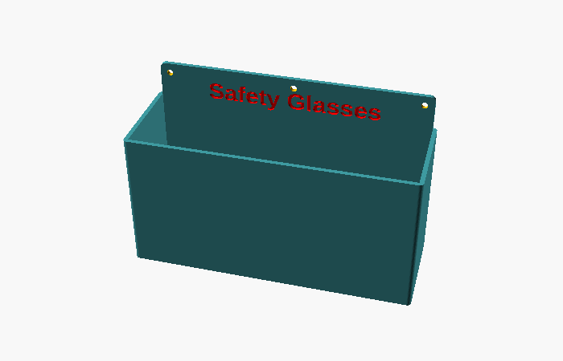

# parametric-wall-bin

A parametric open bin that screws to a wall, with a label engraved on its back
flange, made in OpenSCAD.

## Use it

Open `variable_wall_bin.scad` in [OpenSCAD](https://openscad.org), edit the
variables at the top, render, and export an STL.

| Variable | Default | Description |
| --- | --- | --- |
| `box_length`, `box_width`, `box_height` | 200, 70, 100 | Outside size of the bin, in mm. |
| `wall_thickness` | 3 | Walls and floor. |
| `corner_radius` | 3 | The bin's vertical corners. |
| `mounting_flange` | 25 | How far the back wall rises above the bin, for the screws and label. |
| `screw_diameter` | 4 | Screw size; the holes are 0.5 mm larger. |
| `center_screw` | true | Adds a third screw hole in the middle. |
| `text_string` | "Safety Glasses" | The label. |
| `text_font` | "Arial:style=Bold" | Label font. |
| `text_extrude` | 2 | Engraving depth, into the 3 mm back wall. |
| `label_max_width` | `box_length - 20` | A wider label is scaled down to this width, keeping its proportions. 0 turns this off. |

The label's font size is half the flange's height, and it's engraved into the
flange's front face, centred. Fitting needs an OpenSCAD with `textmetrics()`; 2021.01 doesn't have
it, warns, and leaves the label at full size.

Where Arial isn't installed, as on most Linux systems, fontconfig usually
supplies Liberation Sans, which has the same character widths. If neither is
installed, OpenSCAD uses another font without a warning.

## Printing

The default bin was sliced in PrusaSlicer for a Prusa MK3S with a 0.6 mm
nozzle: PLA at 210 °C, bed 60 °C, 0.35 mm layers (0.2 mm first layer),
2 perimeters, 15 % gyroid infill, a 5 mm brim, and no supports.

## Checks

`just test` takes about 1 s on OpenSCAD 2026.10.15. It renders the bin at the
defaults, with a 285 mm label, fitted and unfitted, on a 300 mm bin, and at
120 × 50 × 60. For each it checks that the bin is one piece of the right size,
and measures the engraved label's width with `tests/label_probe.scad`.
`just images` renders the picture above.

## Licence

MIT; see [LICENSE](LICENSE).
